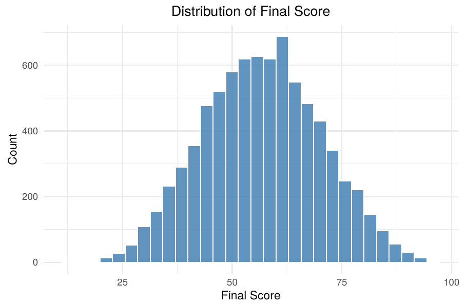
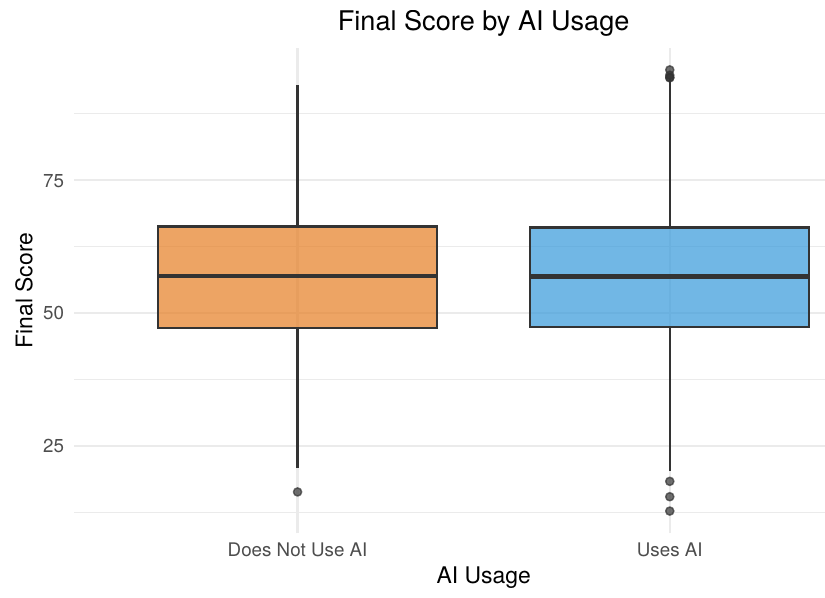
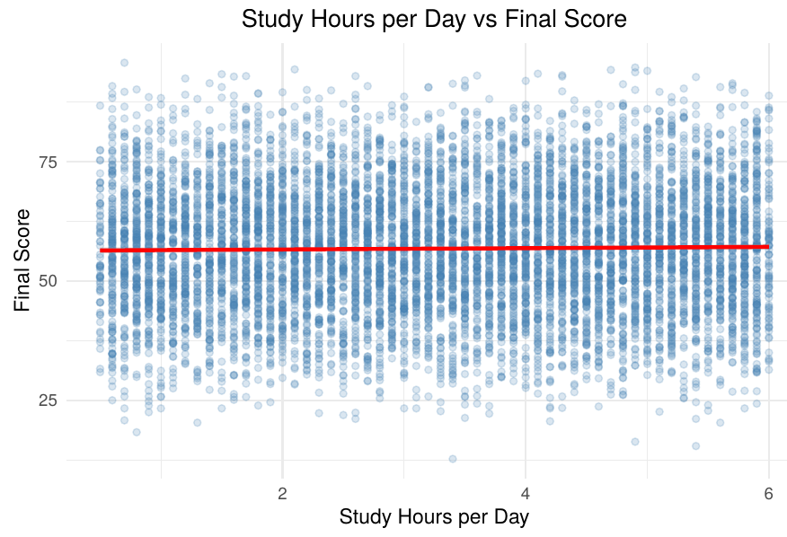
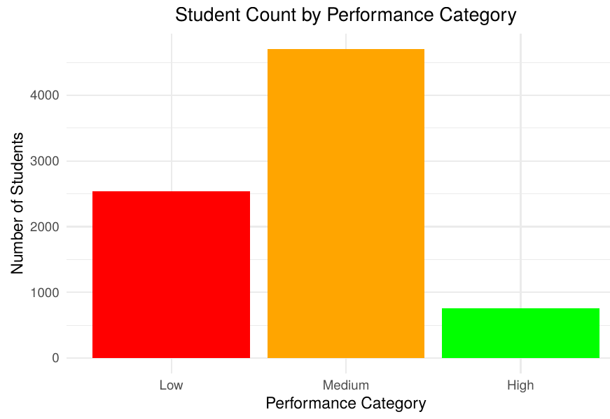
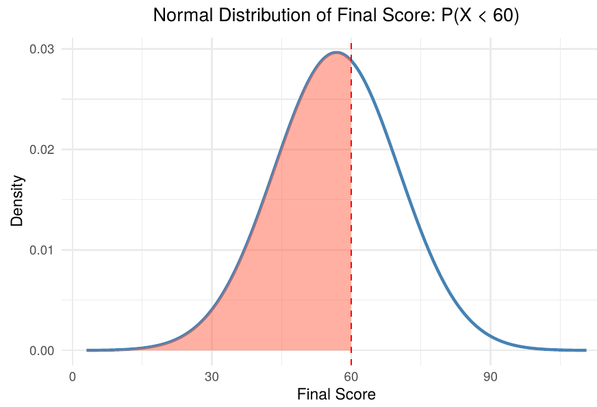

# Impact of AI on Student Performance – Statistical Analysis in R

A statistical and predictive analysis of how AI tool usage, study habits and prior results relate to student performance, using a dataset of **8,000 students and 26 variables**. Written in **R Markdown** with **ggplot2**.

Built for the Computational Mathematics module, BSc (Hons) AI & Data Science, Informatics Institute of Technology.

📄 **[Read the full report with code (PDF)](report.pdf)**

## What I did

1. **Data preparation:** loaded and checked the data for missing values and duplicate rows (none found)
2. **Exploratory analysis:** summary statistics, distributions, category breakdowns and a correlation matrix
3. **Probability:** pass rate, binomial and conditional probabilities, a contingency table, and the normal distribution
4. **Hypothesis testing:** Welch two-sample t-test comparing male and female final scores
5. **Predictive modelling:** simple and multiple linear regression to predict final score

## Key findings

| Question | Result |
|---|---|
| What share of students passed? | **88.9%** (7,114 of 8,000) |
| Does AI usage change final scores? | Median scores are almost identical for AI users and non-users |
| What correlates most with final score? | Last exam score (**r = 0.68**); study hours per day shows almost none (r = 0.02) |
| Do male and female scores differ? | No significant difference (**p = 0.98**) |
| Can study hours alone predict the score? | No: **R² ≈ 0.0002** |
| Can a combined model predict it? | Yes: multiple regression with 7 predictors explains **86% of the variance (R² = 0.862)**; last exam score is the strongest predictor |
| Probability a student scores below 60 | **59.4%** (normal model, mean 56.8, SD 13.5) |

## Charts

| | |
|---|---|
|  |  |
|  |  |

## Tools

R · RStudio · R Markdown · ggplot2 · LaTeX

The dataset was provided by the module and is not included in this repository.
